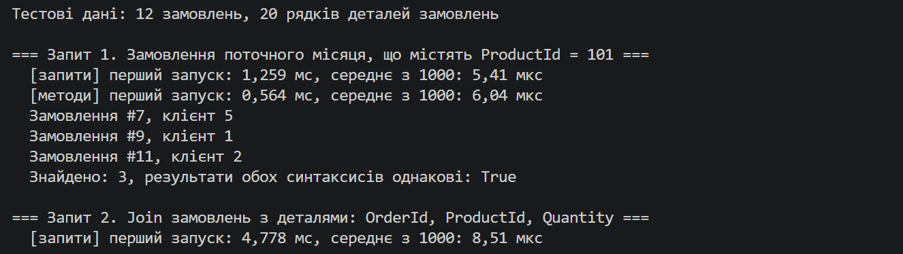
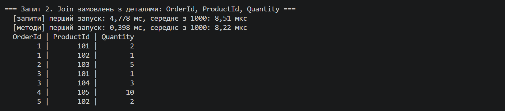
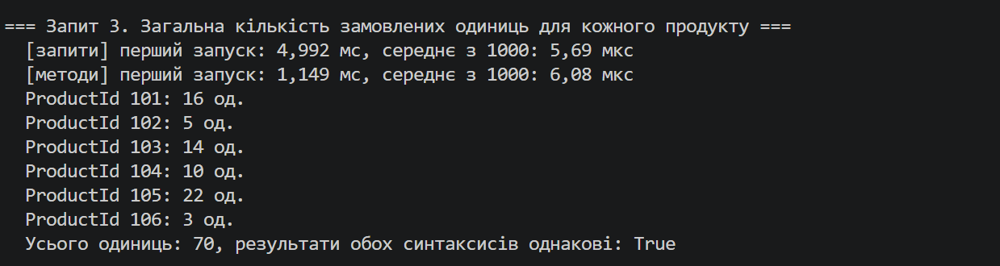
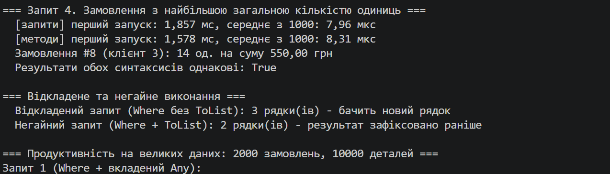

# Лабораторна робота №10

**Тема:** LINQ в дії: фільтри, join, агрегації. Продуктивність.

**Варіант:** 20 — Управління замовленнями та деталями замовлень

**Мета:** Навчитися ефективно використовувати LINQ для фільтрації, об'єднання (join) та агрегації даних, а також аналізувати продуктивність LINQ-запитів.

**Хід роботи:**
1. Створив консольний проєкт lab10v20 у папці OOP-Rybonka командою `dotnet new console -o OOP-Rybonka/lab10v20`.
2. Створив класи сутностей і заповнив колекції тестовими даними (клас `TestData`):
   - `Order` (Id, OrderDate, CustomerId) — 12 замовлень: №1–6 з минулих місяців, №7–12 з поточного. Дати рахуються від `DateTime.Today`, тому запит 1 працює в будь-який місяць;
   - `OrderDetail` (Id, OrderId, ProductId, Quantity, UnitPrice) — 20 рядків, товари з ProductId 101–106;
   - для аналізу продуктивності окремо генерується великий набір: 2 000 замовлень і 10 000 деталей (`Random` з фіксованим seed 42).
3. Для кожного запиту виміряв час через `System.Diagnostics.Stopwatch`:
   - окремо перший запуск (включає JIT-компіляцію) і середній час з 1000 повторів (на великих даних — з 10);
   - кожен запит закінчується `ToList()` / `First()` / `MaxBy()`, тобто вимірюється саме виконання, а не лише створення відкладеного запиту;
   - програма перевіряє, що обидва синтаксиси дають однаковий результат, і наприкінці виводить підсумкову таблицю часу.
4. Продемонстрував відкладене виконання: запит без `ToList()` бачить рядок, доданий у колекцію вже після створення запиту, а запит з `ToList()` — ні.
5. Запустив програму командою `dotnet run`.

**Висновок:** на малих даних усі запити виконуються за кілька мікросекунд, а синтаксис запитів і синтаксис методів дають майже однаковий час (наприклад, 5,41 і 6,04 мкс для запиту 1), бо компілятор перетворює перший на другий. Найдорожчим виявився перший запуск кожного запиту (0,4–5 мс проти 5–8 мкс у середньому) через JIT-компіляцію, а серед самих запитів — join (запит 2) і групування з пошуком максимуму (запит 4), бо вони будують хеш-таблицю і створюють нові об'єкти результату. На великих даних найповільніший запит 1 з вкладеним Any: для кожного замовлення він заново переглядає всі деталі (O(N × M)), а та сама перевірка через попередньо зібраний HashSet працює значно швидше.

