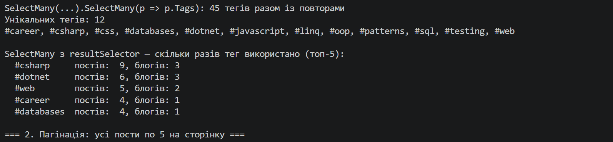
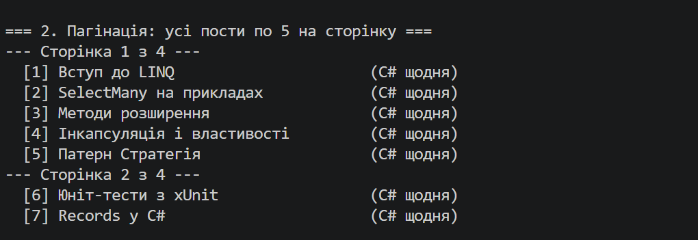
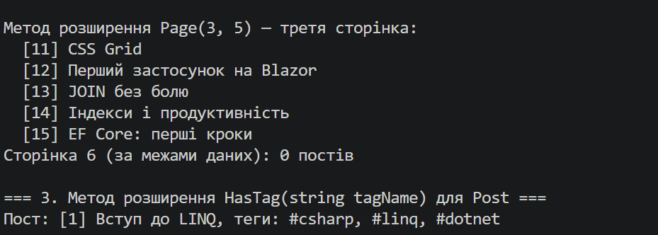
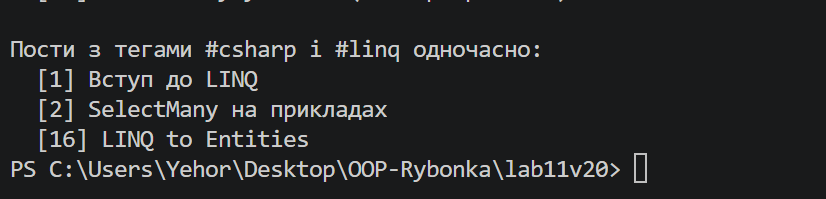

# Лабораторна робота №11

**Тема:** LINQ: SelectMany, пагінація й custom extensions.

**Варіант:** 20 — Блоги та їхні пости з тегами

**Мета:** Навчитися використовувати оператор `SelectMany` для роботи з вкладеними колекціями, реалізовувати пагінацію даних за допомогою LINQ, а також створювати власні методи розширення.

**Хід роботи:**
1. Створив консольний проєкт lab11v20 у папці OOP-Rybonka командою `dotnet new console -o OOP-Rybonka/lab11v20`.
2. Створив класи сутностей з вкладеними колекціями:
   - `Blog` (Id, Name, `List<Post>`);
   - `Post` (Id, Title, `List<Tag>`);
   - `Tag` (Id, Name).
3. Заповнив тестові дані (клас `TestData`): 4 блоги, 20 постів, 12 тегів. Один і той самий тег використовується в кількох постах і блогах, тому є що прибирати при пошуку унікальних.
4. Реалізував запити за варіантом:
   - **SelectMany:** `blogs.SelectMany(b => b.Posts).SelectMany(p => p.Tags)` розгортає дві рівні вкладеності в один список тегів, після чого `DistinctBy(t => t.Id)` залишає унікальні. Для порівняння показав, що `Select(b => b.Posts)` дає колекцію списків, а не плоский список. Додатково використав `SelectMany` з resultSelector, щоб зберегти зв'язок «блог — пост» і порахувати, скільки разів використано кожен тег;
   - **Пагінація:** усі пости виводяться по 5 на сторінку через `Skip((page - 1) * pageSize).Take(pageSize)`, кількість сторінок рахується через `Math.Ceiling`. Також написав узагальнений метод розширення `Page<T>(pageNumber, pageSize)` з перевіркою аргументів;
   - **Custom Extension:** метод розширення `HasTag(string tagName)` для `Post` перевіряє наявність тегу без урахування регістру і символу `#`. Використав його окремо і всередині `Where` для пошуку постів за тегами.
5. Запустив програму командою `dotnet run`.

**Висновок:** `SelectMany` зручно «сплющує» вкладені колекції, а в поєднанні з `DistinctBy` і `GroupBy` дає статистику по тегах без ручних циклів. Пагінація через `Skip`/`Take` займає один рядок, але дані перед нею треба впорядкувати, щоб сторінки були стабільними. Методи розширення дозволяють додати до доменної сутності бізнес-логіку (`HasTag`) і використовувати її в LINQ-запитах так само, як вбудовані оператори.

**Контрольні питання:**
1. `SelectMany` проєктує кожен елемент у колекцію й об'єднує їх в одну послідовність: `blogs.Select(b => b.Posts)` — 4 списки, `blogs.SelectMany(b => b.Posts)` — 20 постів.
2. Пагінація — `Skip((page - 1) * pageSize).Take(pageSize)`, перед цим `OrderBy` для стабільного порядку.
3. Метод розширення — статичний метод статичного класу з `this` перед першим параметром. Усі оператори LINQ — методи розширення `IEnumerable<T>`, тому власні розширення природно вбудовуються в ланцюжок.
4. `Page<T>(this IEnumerable<T> source, int pageNumber, int pageSize)` ховає формулу `Skip`/`Take` і перевіряє аргументи, тому пагінацію будь-якої колекції можна викликати одним методом.

