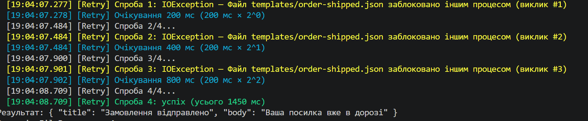
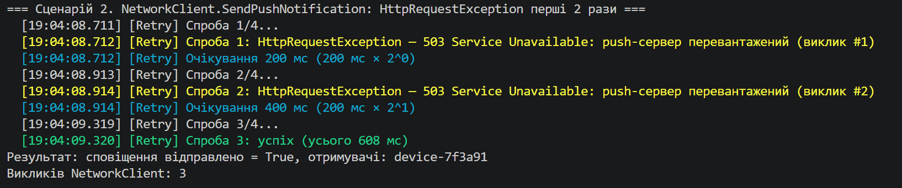
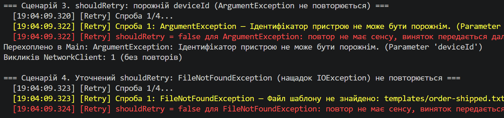
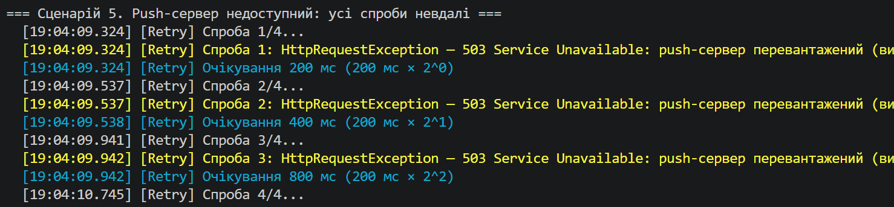

# Лабораторна робота №12

**Тема:** Обробка IO/мережевих помилок та патерн Retry.

**Варіант:** 20 — Відправка push-сповіщення

**Мета:** Навчитися обробляти типові помилки вводу/виводу та мережеві помилки за допомогою блоків try-catch-finally, а також реалізувати патерн Retry для підвищення відмовостійкості застосунків.

**Хід роботи:**
1. Створив консольний проєкт lab12v20 у папці OOP-Rybonka командою `dotnet new console -o OOP-Rybonka/lab12v20`.
2. Реалізував класи за варіантом:
   - `FileProcessor.GetNotificationPayload(string path)` — повертає JSON-шаблон сповіщення; перші 3 виклики викидає `IOException` (файл заблоковано), для шляху не до `.json` — `FileNotFoundException`;
   - `NetworkClient.SendPushNotification(string deviceId, string payload)` — перші 2 виклики викидає `HttpRequestException` (503), для порожнього `deviceId` — `ArgumentException`.
3. Реалізував статичний клас `RetryHelper` з узагальненим методом `ExecuteWithRetry<T>(Func<T> operation, int retryCount = 3, TimeSpan initialDelay = default, Func<Exception, bool>? shouldRetry = null)`:
   - затримка перед повтором — `initialDelay * 2^retryAttempt` (якщо `initialDelay` не задано — 200 мс);
   - логується кожна спроба, тип і текст винятку та тривалість очікування;
   - якщо `shouldRetry` повертає `false` або спроби вичерпано — виняток прокидається далі через `throw;`.
4. `shouldRetry` за варіантом повторює спробу лише для `IOException` та `HttpRequestException`.
5. У `Main` продемонстрував:
   - отримання payload з 4-ї спроби;
   - відправлення сповіщення з 3-ї спроби (метод `void` обгорнуто у `Func<bool>`);
   - `ArgumentException` без повторів;
   - уточнений `shouldRetry`, який не повторює `FileNotFoundException` (нащадок `IOException`, але помилка постійна);
   - недоступний сервер: після всіх спроб виняток перехоплюється в `Main`, `finally` виводить кількість викликів.
6. Запустив програму командою `dotnet run`.

**Висновок:** Експоненційна затримка подвоює паузу з кожною невдалою спробою: при `initialDelay = 200 мс` повтори йдуть через 200, 400 і 800 мс. Короткий збій (заблокований файл, перевантажений push-сервер) зникає за перші кілька спроб, а якщо проблема довша, клієнт не засипає сервер запитами. `shouldRetry` гарантує, що повторюються лише тимчасові помилки, а постійні (порожній `deviceId`, відсутній файл) одразу повертаються викликачу.

**Контрольні питання:**
1. Файли: `FileNotFoundException`, `DirectoryNotFoundException`, `IOException`, `UnauthorizedAccessException`; мережа: `HttpRequestException`, `SocketException`, `TimeoutException`.
2. Retry повторює операцію після тимчасової помилки з паузою між спробами. Він доцільний для тимчасових збоїв і ідемпотентних операцій.
3. Затримка перед повтором номер k — `initialDelay * Math.Pow(2, k)`.
4. `shouldRetry` відокремлює тимчасові помилки, які варто повторювати, від постійних, які треба одразу повернути викликачу.

