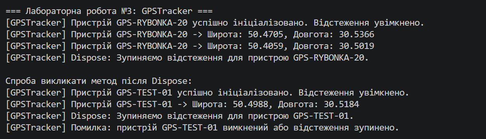

Лабораторна робота No3
• Тема: Життєвий цикл об’єкта та керування ресурсами.
Мета
Поглибити розуміння життєвого циклу об’єкта в C#, навчитися працювати з некерованими
ресурсами, реалізувати інтерфейс IDisposable та патерн Dispose.
Хід роботи : Реалізація класу GPSTracker у Program.cs
Оголосив приватні поля _deviceId (string) та _isTracking (bool).
Створив конструктор для ініціалізації пристрою та ввімкнення відстеження.
Реалізував метод GetCurrentLocation(), який імітує генерування координат.
Імплементував інтерфейс IDisposable (метод Dispose()), який зупиняє відстеження (_isTracking = false).
Тестування та демонстрація в Main
Продемонстрував роботу об'єкта через блок using для автоматичного виклику Dispose().
Перевірив ручний виклик Dispose() і переконався, що після зупинки відстеження виводиться повідомлення про вимкнений стан.
