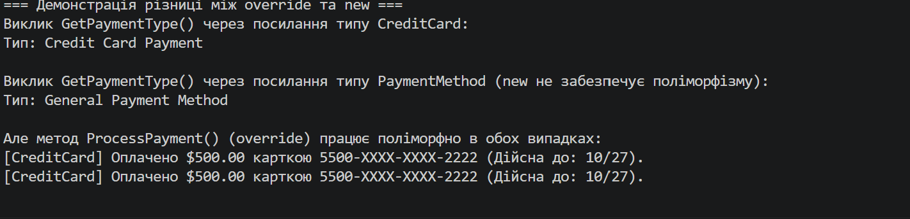

Лабораторна робота No4
• Тема: Наслідування. Ключові слова base, override, virtual. Приховування членів (new).
Мета
Навчитися створювати ієрархії класів, використовувати ключові слова base, virtual, override
для реалізації поліморфізму, а також розуміти відмінності між override та приховуванням членів
за допомогою new.
Хід роботи : Створив проєкт lab6v20 у папці OOP-Rybonka через dotnet new console.
Реалізував базовий клас PaymentMethod з віртуальним методом ProcessPayment().
Створив похідні класи CreditCard та PayPal, застосувавши base(), override та унікальні методи.
У класі CreditCard використав new для приховування методу GetPaymentType().
У Main перевірив поліморфізм через масив PaymentMethod[] та відмінність між override і new.
Протестував проєкт командою dotnet run.

