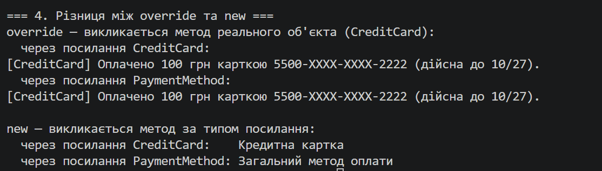

# Лабораторна робота №6

**Тема:** Наслідування. Ключові слова base, override, virtual. Приховування членів (new).

**Варіант:** 20 — ієрархія PaymentMethod → CreditCard → PayPal

**Мета:** Навчитися створювати ієрархії класів, використовувати ключові слова base, virtual, override для реалізації поліморфізму, а також розуміти відмінності між override та приховуванням членів за допомогою new.

**Хід роботи:**
1. Створив консольний проєкт lab6v20 у папці OOP-Rybonka командою `dotnet new console -o OOP-Rybonka/lab6v20`.
2. Реалізував базовий клас PaymentMethod з приватними полями та публічними властивостями Name, IsActive, конструктором, віртуальним методом `virtual void ProcessPayment(decimal amount)` і звичайним методом `string GetMethodType()`.
3. Створив похідний клас CreditCard з властивостями CardNumber, ExpiryDate, конструктором через `base(...)`, перевизначеним `override void ProcessPayment(decimal amount)`, власним методом `AuthorizeTransaction()` та методом `new string GetMethodType()`, що приховує метод базового класу.
4. Створив похідний клас PayPal з властивістю Email, конструктором через `base(...)`, перевизначеним `override void ProcessPayment(decimal amount)` і власним методом `SendInvoice()`.
5. У методі Main створив об'єкти всіх класів, викликав унікальні методи, продемонстрував поліморфізм через масив `PaymentMethod[]` та різницю між override і new при виклику через посилання типу CreditCard і PaymentMethod.
6. Запустив програму командою `dotnet run`.

