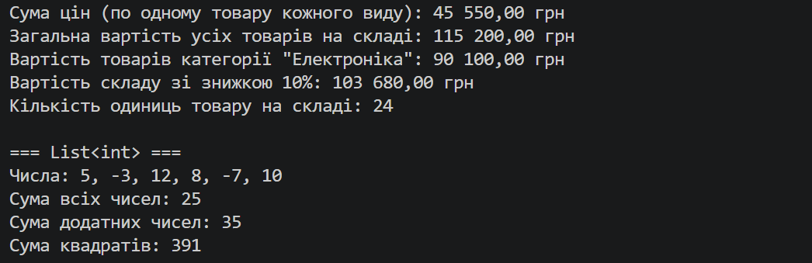

# Лабораторна робота №8

Тема: Делегати й лямбда-вирази у практиці колекцій: CollectionHelper

Варіант: 20 — CollectionHelper\<T> з методом Sum

Мета: Навчитися передавати поведінку як параметр через делегати Func, Action, Predicate, будувати на цій основі універсальні операції над колекціями та використовувати лямбда-вирази у практиці ООП.

Хід роботи:
1. Створив консольний проєкт lab8v20 у папці OOP-Rybonka командою dotnet new console -o OOP-Rybonka/lab8v20.
2. Реалізував статичний узагальнений клас CollectionHelper\<T> з методом за варіантом:
   public static decimal Sum(IEnumerable\<T> collection, Func\<T, decimal> selector)
   Метод перебирає колекцію власним циклом foreach (без виклику LINQ Sum), для кожного елемента викликає делегат selector і накопичує результат. Для порожньої колекції повертає 0, для null викидає ArgumentNullException.
3. Створив клас Product (Name, Category, Price, Quantity).
4. У методі Main продемонстрував роботу Sum на трьох різних колекціях з різними лямбда-виразами:
   - List\<Product>: сума цін, загальна вартість складу (p => p.Price * p.Quantity), вартість однієї категорії, вартість зі знижкою (лямбда в змінній Func\<Product, decimal>), кількість одиниць;
   - List\<int>: сума чисел, сума лише додатних, сума квадратів;
   - List\<string>: загальна кількість символів, кількість довгих слів.
5. Перевірив граничні випадки (порожня колекція, null) і порівняв результат з LINQ Sum.
6. Запустив програму командою dotnet run.

