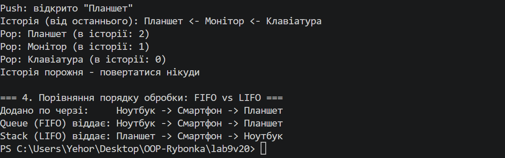

# Лабораторна робота №9

**Тема:** HashSet/Queue/Stack: практичні сценарії.

**Варіант:** 20 — Система рекомендацій

**Мета:** Навчитися використовувати спеціалізовані колекції `HashSet<T>`, `Queue<T>`, `Stack<T>` для розв'язання практичних задач, зрозуміти їхні особливості та сценарії застосування.

**Хід роботи:**
1. Створив консольний проєкт lab9v20 у папці OOP-Rybonka командою `dotnet new console -o OOP-Rybonka/lab9v20`.
2. Створив клас `User` (ім'я та множина вже куплених продуктів) і клас `RecommendationSystem`, у якому кожна колекція виконує свою підзадачу варіанту.
3. `HashSet<string>` — унікальні продукти для рекомендацій:
   - `Add` повертає `false` для дубліката, регістр не враховується (`StringComparer.OrdinalIgnoreCase`);
   - `UnionWith` додає новинки з іншого джерела, `Contains` перевіряє наявність, `Remove` знімає продукт з продажу;
   - `ExceptWith` прибирає з рекомендацій те, що користувач уже купив;
   - окремо показано, як `HashSet` прибирає дублікати зі списку переглядів.
4. `Queue<User>` — черга користувачів для обробки:
   - `Enqueue` додає користувачів, `Peek` показує наступного без видалення, `Dequeue` у циклі забирає їх по черзі (FIFO);
   - кожен оброблений користувач отримує до 3 рекомендацій;
   - `Dequeue` на порожній черзі викидає `InvalidOperationException`.
5. `Stack<string>` — історія переглянутих рекомендацій:
   - `Push` при відкритті рекомендації, `Peek` показує, що відкрито зараз;
   - `Pop` працює як кнопка «Назад»: першою закривається остання відкрита рекомендація (LIFO).
6. Окремо порівняв порядок обробки однакових елементів у `Queue` (FIFO) і `Stack` (LIFO).
7. Запустив програму командою `dotnet run`.

